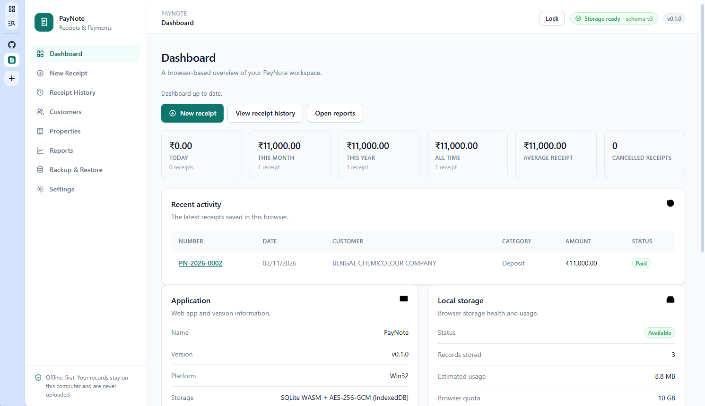

# PayNote

**Simple Receipts. Organized Payments.**

PayNote is a browser-based receipt and payment manager for small businesses. It runs entirely in your browser — no server, no account, no cloud. Records are stored locally in SQLite (WASM), encrypted with AES-256-GCM and kept in IndexedDB, and the app works offline as an installable PWA.

## Tech Stack

- TypeScript (no framework — plain DOM components)
- [SQLite WASM](https://sqlite.org/wasm) running in memory, with the database persisted as AES-GCM ciphertext in IndexedDB
- Web Crypto API for PBKDF2 key derivation and AES-256-GCM
- [qrcode](https://www.npmjs.com/package/qrcode) for receipt QR codes
- [Guchho](https://www.npmjs.com/package/guchho) for dev server, bundling, linting, and serving
- [@guchho/test](https://www.npmjs.com/package/@guchho/test) for the test runner

## Data & Privacy

- All data stays on your device in an encrypted SQLite database inside IndexedDB. Nothing is sent to a server.
- The database is encrypted with a random 256-bit data key. Your PIN derives a separate key-encryption key that wraps the data key; the data key exists in memory only while the app is unlocked.
- A forgotten PIN means the encrypted database cannot be recovered.
- Two separate workspaces are available: **Business** and **Individual**. They keep independent records in the same encrypted database.
- Clearing browser data or site storage will delete your records. **Export a backup regularly** from the Backup & Restore page.
- Backups download as decrypted JSON after you confirm your PIN, so store backup files somewhere safe.
- Receipt drafts are kept in local storage for crash recovery and are cleared whenever you lock the app. They are not stored inside the encrypted database.
- A 4-digit PIN has only 10,000 possible values, so it is a convenience lock, not strong protection against a determined offline attacker who copies the encrypted database.

## License

PayNote is licensed under **[MIT](LICENSE)**. Copyright © [Hemanta Gayen](https://github.com/hemanta-gayen).
